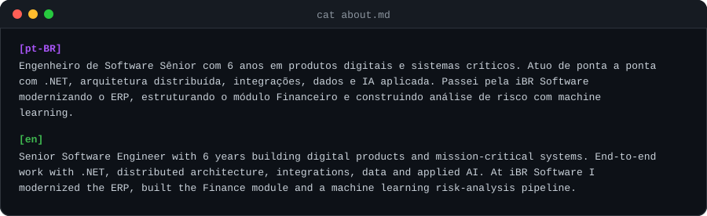
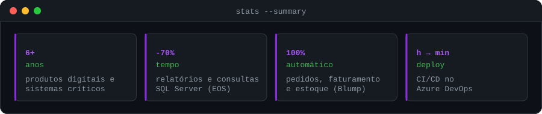
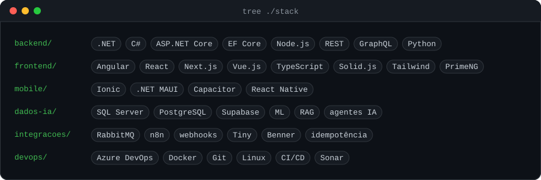
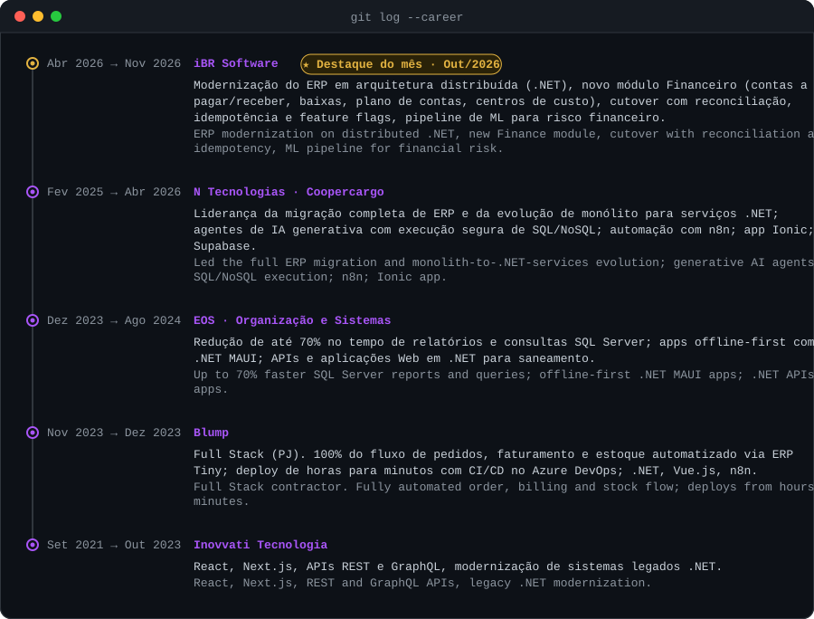
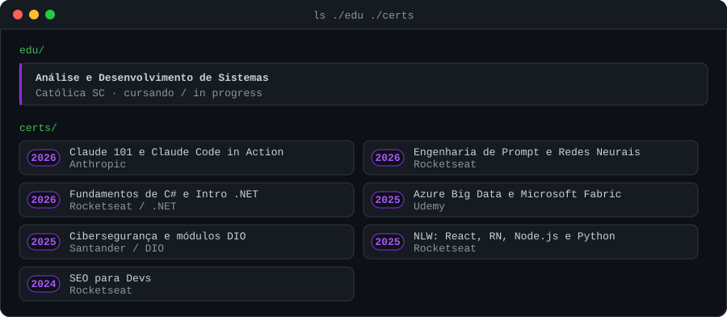
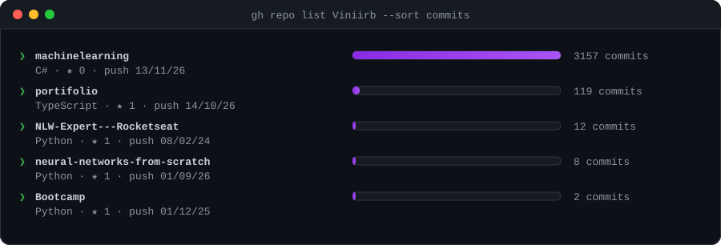

  

## `$ cat about.md`

  

  

## `$ tree ./stack`

  

## `$ git log --career`

  

## `$ ls ./edu ./certs`

  

## `$ gh repo list`

  

<!-- REPOS-LIST:START -->

| Repositório | Descrição | Stack |
|---|---|---|
| [**machinelearning**](https://github.com/Viniirb/machinelearning) | ML.NET is an open source and cross-platform machine learning framework for .NET. | `C#` |
| [**portifolio**](https://github.com/Viniirb/portifolio) | Este repositório refere-se sobre a criação do meu portifólio profissional | `TypeScript` |
| [**neural-networks-from-scratch**](https://github.com/Viniirb/neural-networks-from-scratch) | Trilha educacional em português sobre redes neurais: do perceptron a CNNs, LSTMs e Transformers, com exemplos em Python e TensorFlow. | `Python` |
| [**Bootcamp**](https://github.com/Viniirb/Bootcamp) | Exercícios e projetos de bootcamp em Python | `Python` |
| [**NLW-Expert---Rocketseat**](https://github.com/Viniirb/NLW-Expert---Rocketseat) | Criação de uma aplicação de barcode realizada pela Rocketseat na NLW Expert | `Python` |

<!-- REPOS-LIST:END -->

---

  Os cards de repositórios e a lista acima são gerados por GitHub Actions · Repo cards and list above are generated by GitHub Actions

